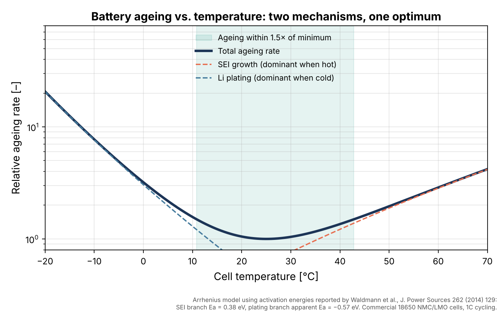

# Battery Thermal Modeling: Key Papers Explained

Short, readable Python notebooks that go with a LinkedIn series on battery thermal modeling. Each part picks one topic, explains the key paper behind it, and rebuilds the main idea in a few lines of code.

Everything here is built from published literature. No proprietary data is used.

## Notebooks

| Part | Topic | Notebook | Main reference |
|---|---|---|---|
| 1 | How temperature affects battery ageing | [01_ageing_vs_temperature.ipynb](notebooks/01_ageing_vs_temperature.ipynb) | Waldmann et al., J. Power Sources 262 (2014) 129 |

More parts will be added as the series goes on.



## Getting started

```bash
git clone https://github.com/siancfd/battery-thermal-modeling.git
cd battery-thermal-modeling
pip install -r requirements.txt
jupyter notebook
```

Then open a notebook in the `notebooks` folder and choose **Run All**. Figures are saved to `figures/`.

## References

1. T. Waldmann, M. Wilka, M. Kasper, M. Fleischhammer, M. Wohlfahrt-Mehrens, *Temperature dependent ageing mechanisms in Lithium-ion batteries – A Post-Mortem study*, Journal of Power Sources 262 (2014) 129–135. https://doi.org/10.1016/j.jpowsour.2014.03.112

The papers themselves are not included in this repository. Please use the DOI links to access them.

## A note on accuracy

These notebooks are for learning. They use simplified models with parameters taken from published studies on specific cells, so the results show trends and mechanisms, not design values for any particular battery.

## License

Code is released under the [MIT License](LICENSE).
